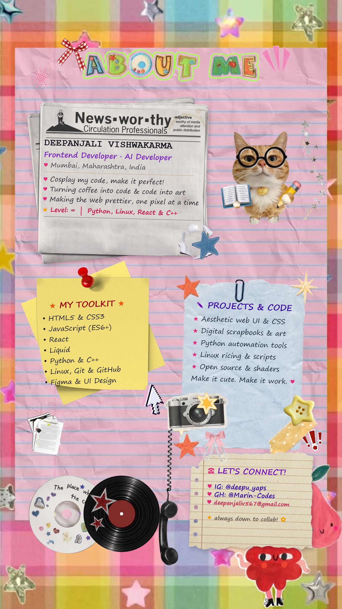

<!-- ═══════════════════════════════════════════════════════════════════
     ✦  M A R I N . E X E  —  D I G I T A L   S C R A P B O O K  ✦
     ═══════════════════════════════════════════════════════════════════ -->

<!-- § 1 · THE COMPLETE PINK SCRAPBOOK PAGE (built on background2.jpg) -->

  

<!-- § 2 · CLICKABLE SOCIALS & VISITOR STAMP -->

&nbsp;

&nbsp;

 

 
<!-- § 3 · LIVE CONTRIBUTION GARDEN -->
<h3>✦ ᴄᴏɴᴛʀɪʙᴜᴛɪᴏɴ ɢᴀʀᴅᴇɴ ✦</h3>

<picture>
  <source media="(prefers-color-scheme: dark)" srcset="https://raw.githubusercontent.com/Marin-Codes/Marin-Codes/output/github-snake-dark.svg"/>
  <source media="(prefers-color-scheme: light)" srcset="https://raw.githubusercontent.com/Marin-Codes/Marin-Codes/output/github-snake.svg"/>
  
</picture>
 

<!-- § 4 · LIVE STATS & STREAKS (PINK PAPER THEME) -->
<h3>✦ ꜱᴛᴀᴛꜱ &amp; ꜱᴛʀᴇᴀᴋꜱ ✦</h3>

<table>
<tr>
<td align="center" valign="middle">

</td>
<td align="center" valign="middle">

</td>
</tr>
</table>
 
<!-- § 5 · CLOSING SIGN-OFF -->
✿ ᴛʜᴀɴᴋ ʏᴏᴜ ꜰᴏʀ ᴠɪꜱɪᴛɪɴɢ ᴍʏ ᴅɪɢɪᴛᴀʟ ꜱᴄʀᴀᴘʙᴏᴏᴋ · ᴍᴀᴅᴇ ᴡɪᴛʜ ♥ ʙʏ ᴅᴇᴇᴘᴀɴᴊᴀʟɪ ✿

