

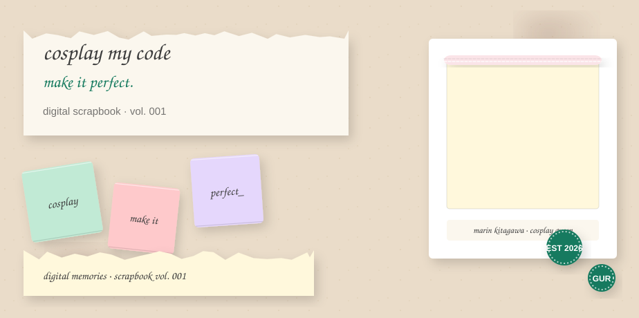

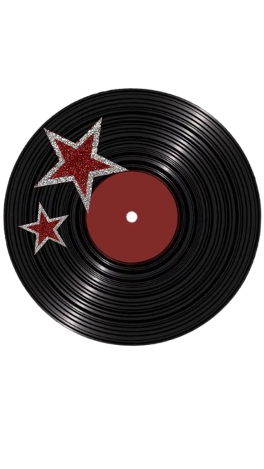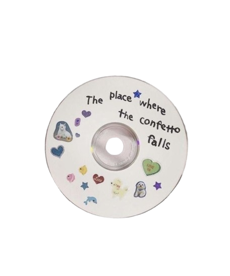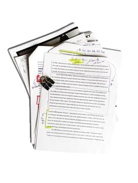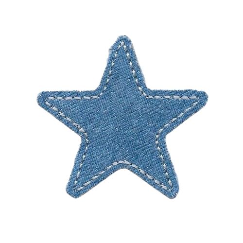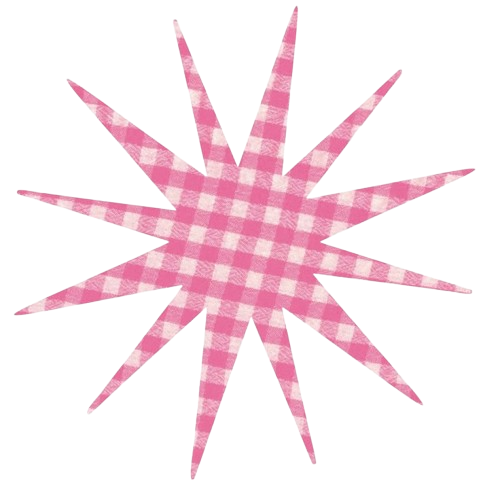

<table width="100%" cellpadding="14" cellspacing="0">
  <tr>
    <td width="42%" align="center" valign="middle">
      
      
    </td>
    <td width="58%" align="center" valign="middle">
      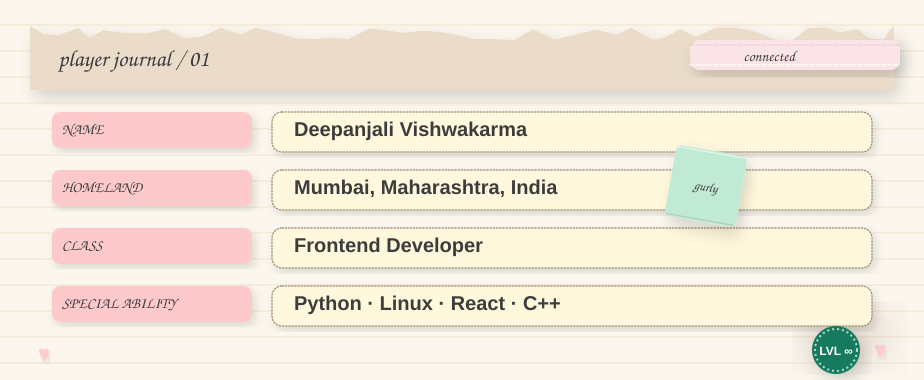
      
    </td>
  </tr>
</table>

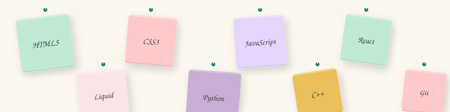

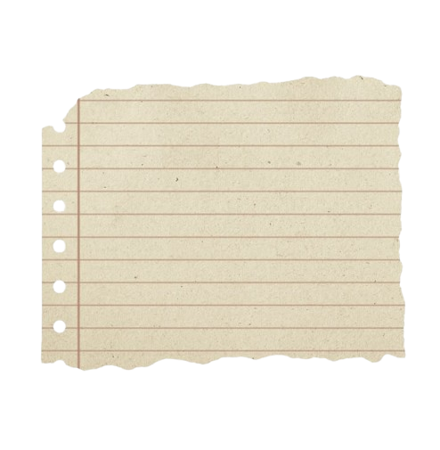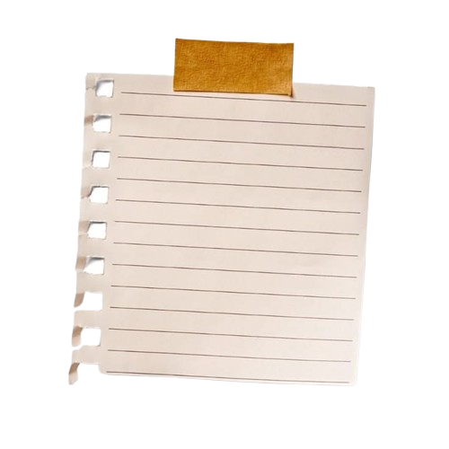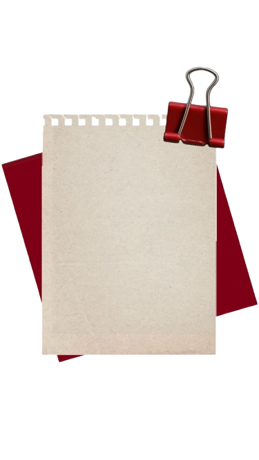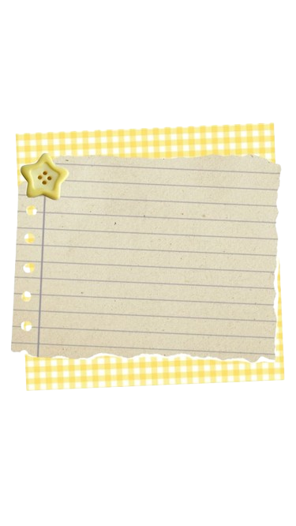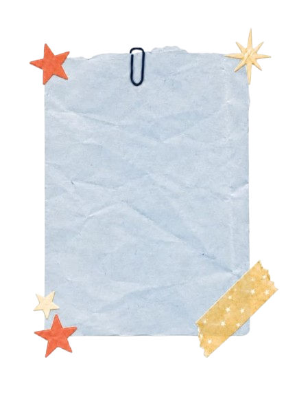

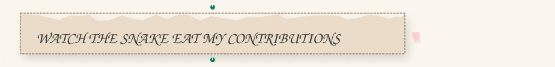

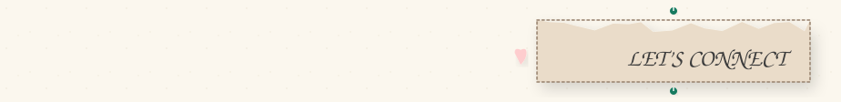

<a href="mailto:deepanjali3346@gmail.com">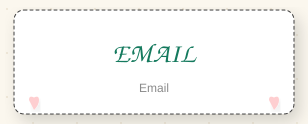</a><a href="https://github.com/Marin-Codes">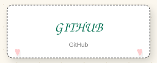</a><a href="https://www.instagram.com/deepanjali.says">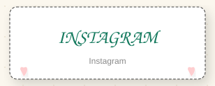</a>

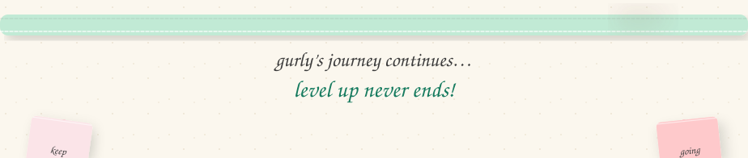

