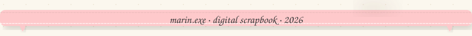
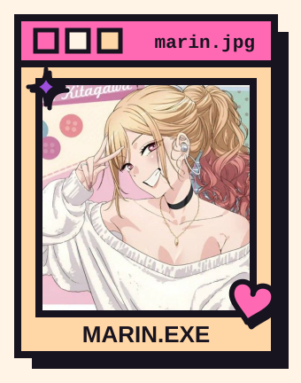

<table width="100%" cellpadding="14" cellspacing="0">
  <tr>
    <td width="42%" align="center" valign="middle">
      
    </td>
    <td width="58%" align="center" valign="middle">
      
    </td>
  </tr>
</table>

