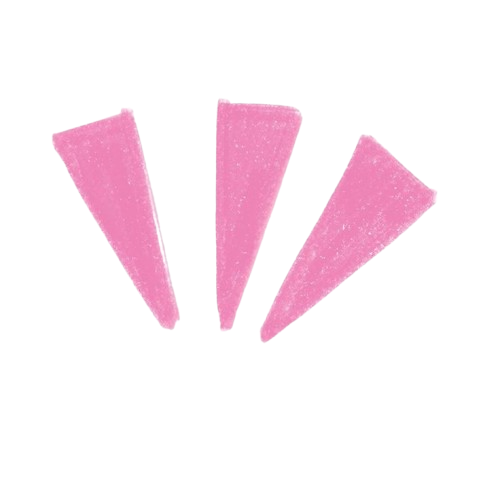
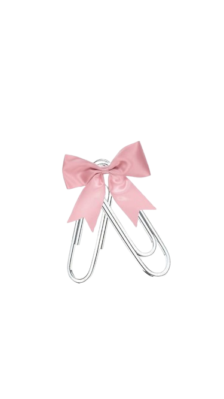
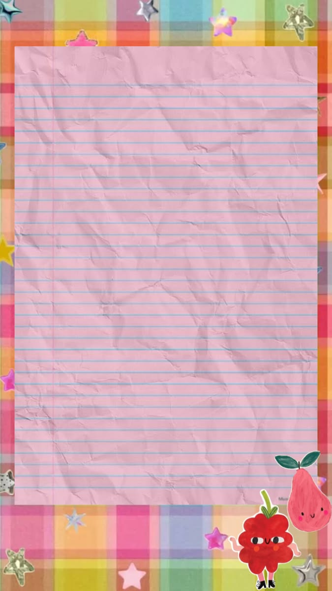
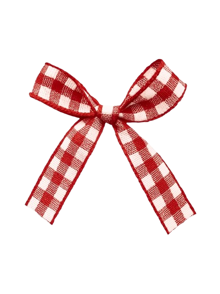
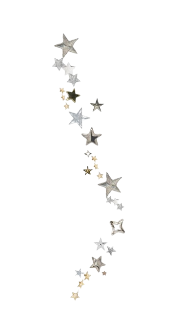
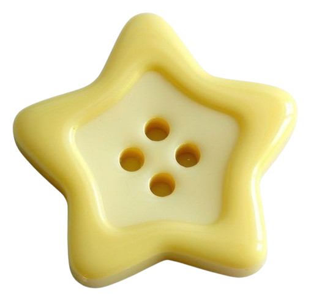
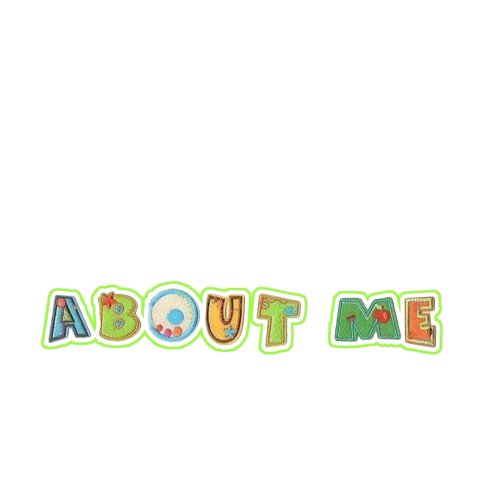
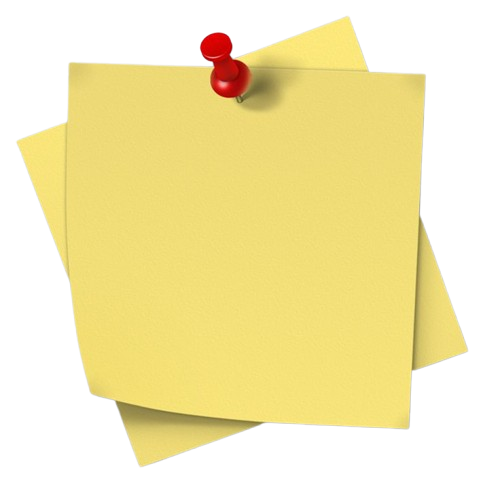
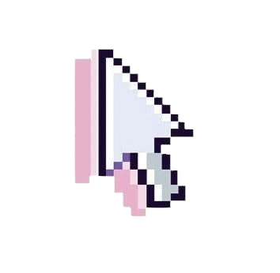
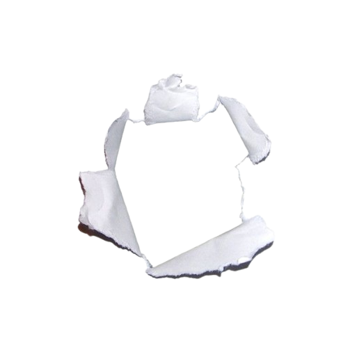

<div align="center">

<!-- ═══════════════════════════════════════════════════════════════════
     ✦  D I G I T A L   S C R A P B O O K  ✦
     ═══════════════════════════════════════════════════════════════════ -->

<!-- ✿ DECORATIVE HEADER STRIP ✿ -->





<br>

<!-- ═══════════════════════════════════════════════════════════════
     § 1 ·  HERO BANNER
     ═══════════════════════════════════════════════════════════════ -->

<table><tr><td>



</td></tr></table>

<br>

<!-- ═══════════════════════════════════════════════════════════════
     § 2 ·  PROFILE INTRO — NEWSPAPER CLIPPING STYLE
     ═══════════════════════════════════════════════════════════════ -->

<table>
<tr>
<td width="320" align="center" valign="top">


<br>

<br>


</td>
<td width="540" valign="top">


### ✎ ᴡᴇʟᴄᴏᴍᴇ ᴛᴏ ᴍʏ ᴅɪɢɪᴛᴀʟ ꜱᴄʀᴀᴘʙᴏᴏᴋ

> *ʜᴇʏ, ɪ'ᴍ* **ᴅᴇᴇᴘᴀɴᴊᴀʟɪ ᴠɪꜱʜᴡᴀᴋᴀʀᴍᴀ** ♡
>
> *ꜰʀᴏɴᴛᴇɴᴅ ᴅᴇᴠᴇʟᴏᴘᴇʀ · ᴄᴏᴅᴇ ᴀʀᴛɪꜱᴛ · ᴅɪɢɪᴛᴀʟ ᴅʀᴇᴀᴍᴇʀ*

🏡 ᴍᴜᴍʙᴀɪ, ᴍᴀʜᴀʀᴀꜱʜᴛʀᴀ, ɪɴᴅɪᴀ

🌸 ᴛᴜʀɴɪɴɢ ᴄᴏꜰꜰᴇᴇ ɪɴᴛᴏ ᴄᴏᴅᴇ & ᴄᴏᴅᴇ ɪɴᴛᴏ ᴀʀᴛ

✿ ᴍᴀᴋɪɴɢ ᴛʜᴇ ᴡᴇʙ ᴘʀᴇᴛᴛɪᴇʀ, ᴏɴᴇ ᴘɪxᴇʟ ᴀᴛ ᴀ ᴛɪᴍᴇ



</td>
</tr>
</table>

<br>

<!-- ✿ DECORATIVE DIVIDER ✿ -->

&nbsp;&nbsp;

&nbsp;&nbsp;

&nbsp;&nbsp;

&nbsp;&nbsp;


<br><br>

<!-- ═══════════════════════════════════════════════════════════════
     § 3 ·  ABOUT ME — SCRAPBOOK JOURNAL
     ═══════════════════════════════════════════════════════════════ -->



<br><br>

<table>
<tr>
<td width="140" align="center" valign="top">


</td>
<td width="400" align="center">



</td>
<td width="140" align="center" valign="top">

<br><br>

<br><br>


</td>
</tr>
</table>

<table>
<tr><td>

```
╭──────────────────────────────────────────────────────╮
│                                                      │
│   ♡  ɴᴀᴍᴇ ·  Deepanjali Vishwakarma                 │
│   ♡  ʜᴏᴍᴇ ·  Mumbai, Maharashtra, India             │
│   ♡  ᴄʟᴀꜱꜱ · Frontend Developer                     │
│   ♡  ꜱᴋɪʟʟ · Python, Linux, React & C++             │
│   ♡  ᴠɪʙᴇ ·  Aesthetic code, creative builds        │
│                                                      │
│   "ᴛʜᴇ ᴘʟᴀᴄᴇ ᴡʜᴇʀᴇ ᴛʜᴇ ᴄᴏɴꜰᴇᴛᴛᴏ ꜰᴀʟʟꜱ" ✦        │
│                                                      │
╰──────────────────────────────────────────────────────╯
```

</td></tr>
</table>

<br>


<br><br>

<!-- ═══════════════════════════════════════════════════════════════
     § 4 ·  SKILLS & TOOLKIT — STICKY NOTES
     ═══════════════════════════════════════════════════════════════ -->

<table>
<tr>
<td align="center" valign="top">


**ꜰʀᴏɴᴛᴇɴᴅ**

</td>
<td align="center" valign="top">


**ʙᴀᴄᴋᴇɴᴅ**

</td>
<td align="center" valign="top">


**ᴛᴏᴏʟꜱ**

</td>
<td align="center" valign="top">


**ʟᴇᴀʀɴɪɴɢ**

</td>
</tr>
<tr>
<td align="center" valign="top">

`HTML5`  `CSS3`
`JavaScript`
`React`  `Liquid`

</td>
<td align="center" valign="top">

`Python`  `C++`
`Node.js`
`Linux`

</td>
<td align="center" valign="top">

`Git`  `GitHub`
`VS Code`
`Figma`

</td>
<td align="center" valign="top">

`TypeScript`
`Next.js`
`Tailwind`

</td>
</tr>
</table>

<br>

<!-- ✿ DISC & STICKER SCATTER ✿ -->

&nbsp;&nbsp;&nbsp;

&nbsp;&nbsp;&nbsp;

&nbsp;&nbsp;&nbsp;


<br><br>

<!-- ═══════════════════════════════════════════════════════════════
     § 5 ·  PROJECTS & INTERESTS — TORN NOTEBOOK PAGE
     ═══════════════════════════════════════════════════════════════ -->

<table>
<tr>
<td width="540" valign="top">


### ✎ ᴘʀᴏᴊᴇᴄᴛꜱ & ɪɴᴛᴇʀᴇꜱᴛꜱ

> 🌷 ᴄʀᴀꜰᴛɪɴɢ ʙᴇᴀᴜᴛɪꜰᴜʟ ꜰʀᴏɴᴛᴇɴᴅ ᴇxᴘᴇʀɪᴇɴᴄᴇꜱ
>
> 🎨 ᴅᴇꜱɪɢɴɪɴɢ ᴄʀᴇᴀᴛɪᴠᴇ ᴜɪ ᴄᴏᴍᴘᴏɴᴇɴᴛꜱ
>
> 🐍 ᴘʏᴛʜᴏɴ ᴀᴜᴛᴏᴍᴀᴛɪᴏɴ & ꜱᴄʀɪᴘᴛɪɴɢ
>
> 🐧 ʟɪɴᴜx ꜱʏꜱᴛᴇᴍ ᴀᴅᴍɪɴɪꜱᴛʀᴀᴛɪᴏɴ
>
> ✦ ᴏᴘᴇɴ ꜱᴏᴜʀᴄᴇ ᴄᴏɴᴛʀɪʙᴜᴛɪᴏɴꜱ

</td>
<td width="260" align="center" valign="top">

<br>

<br><br>

<br><br>


</td>
</tr>
</table>

<br>

<!-- ✿ DECORATIVE DIVIDER ✿ -->

&nbsp;&nbsp;

&nbsp;&nbsp;

&nbsp;&nbsp;

&nbsp;&nbsp;

&nbsp;&nbsp;

&nbsp;&nbsp;


<br><br>

<!-- ═══════════════════════════════════════════════════════════════
     § 6 ·  GITHUB CONTRIBUTION SNAKE
     ═══════════════════════════════════════════════════════════════ -->

### ✦ ᴄᴏɴᴛʀɪʙᴜᴛɪᴏɴ ɢᴀʀᴅᴇɴ ✦

<picture>
  <source media="(prefers-color-scheme: dark)" srcset="https://raw.githubusercontent.com/Marin-Codes/Marin-Codes/output/github-snake-dark.svg"/>
  <source media="(prefers-color-scheme: light)" srcset="https://raw.githubusercontent.com/Marin-Codes/Marin-Codes/output/github-snake.svg"/>
  
</picture>

<br><br>

<!-- ═══════════════════════════════════════════════════════════════
     § 7 ·  STATS — SCRAPBOOKED
     ═══════════════════════════════════════════════════════════════ -->

### ✦ ꜱᴛᴀᴛꜱ & ꜱᴛʀᴇᴀᴋꜱ ✦

<table>
<tr>
<td align="center" valign="top">


</td>
<td align="center" valign="top">


</td>
</tr>
</table>

<br>


<br><br>

<!-- ✿ STICKER SCATTER ✿ -->

&nbsp;&nbsp;

&nbsp;&nbsp;

&nbsp;&nbsp;


<br><br>

<!-- ═══════════════════════════════════════════════════════════════
     § 8 ·  LET'S CONNECT — CONTACT SECTION
     ═══════════════════════════════════════════════════════════════ -->

<table>
<tr>
<td width="160" align="center" valign="top">


</td>
<td width="500" valign="top">

### ✦ ʟᴇᴛ'ꜱ ᴄᴏɴɴᴇᴄᴛ ✦

<br>

<a href="https://www.instagram.com/marin.codes/">
  
</a>
&nbsp;
<a href="https://github.com/Marin-Codes">
  
</a>
&nbsp;
<a href="https://pin.it/4s6i1Epfi">
  
</a>
&nbsp;
<a href="mailto:deepanjaliv567@gmail.com">
  
</a>

<br><br>


</td>
<td width="160" align="center" valign="middle">


<br>


</td>
</tr>
</table>

<br>

<!-- ═══════════════════════════════════════════════════════════════
     § 9 ·  FOOTER — CLOSING SCRAPBOOK PAGE
     ═══════════════════════════════════════════════════════════════ -->


<br><br>

```
 ✿ ᴛʜᴀɴᴋ ʏᴏᴜ ꜰᴏʀ ᴠɪꜱɪᴛɪɴɢ ᴍʏ ꜱᴄʀᴀᴘʙᴏᴏᴋ ✿
         ᴍᴀᴅᴇ ᴡɪᴛʜ ♡ ʙʏ ᴅᴇᴇᴘᴀɴᴊᴀʟɪ
```

<br>


&nbsp;&nbsp;&nbsp;

&nbsp;&nbsp;&nbsp;


<br>


<br>

</div>
